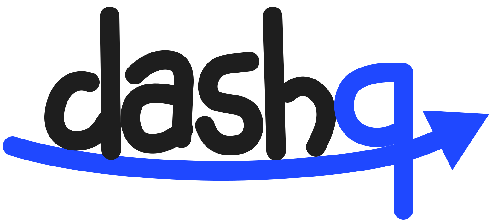
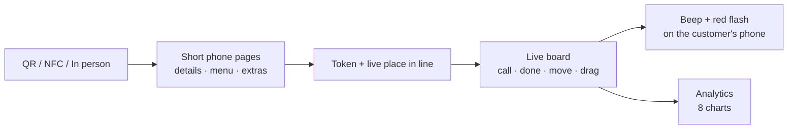
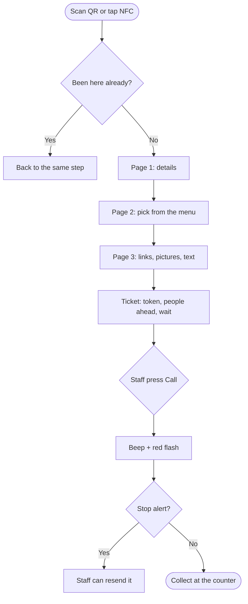

<p align="center">
  
</p>

<h3 align="center">Run your queue from a laptop. No app needed.</h3>

<p align="center">
  <a href="https://dashq.azurewebsites.net"><b>Live demo</b></a> ·
  <a href="#how-it-works">How it works</a> ·
  <a href="#run-it-yourself">Run it</a> ·
  <a href="dashQ_how_it_works.md">Full technical notes</a>
</p>

<p align="center">
  
  
  
  
  
</p>

---

## The problem

Between lectures, the campus cafe counter is a crowd. At a dental clinic, patients sit in the waiting room with no idea how long it will take. Nobody wants to download an app just to stand in a line.

## What dashQ does

dashQ turns any counter into a managed queue in five minutes.

| | |
|---|---|
| **Three ways to join** | Scan a **QR code**, tap an **NFC sticker**, or get added **in person** by staff. Every card on the board shows `QR`, `NFC` or `IP`. |
| **Short phone pages** | Up to 3 pages: your details → pick from a menu or list of services → links, pictures and text (like how to pay). Each page can be switched off. |
| **A token with a live place in line** | People ahead, an estimated wait, and which stage they're in (*Ordered → Preparing → Ready to collect*). |
| **"It's your turn" alert** | The phone **beeps and flashes red**. The customer can stop the alert, and staff can resend it. |
| **A live board for staff** | One column per line. Call next, done, move, remove, drag to reorder, add walk-ins with their order. Updates on its own every 3 seconds. |
| **Analytics** | 8 charts: joins per day, how people join, busiest times heatmap, wait by hour, most picked items, line length vs wait, wait distribution, completed vs left. |
| **Picks up where you left off** | Close the tab by mistake, scan again, and you're back on the same step. |

**Try it:** open the [live demo](https://dashq.azurewebsites.net/app/login) and click **Encave Cafe** or **Sociovate** to open a sample business.

---

## Who it's for

<table>
<tr>
<td width="50%" valign="top">

**Encave** · cafe inside MIT-WPU, Pune

Students book from a QR on the table, order from the menu on their phone, and get an alert when the food is ready.

*Ordered → Preparing → Ready to collect*

</td>
<td width="50%" valign="top">

**Sociovate** · agency for dental clinics

Patients see their place in line and an estimated wait. The front desk calls the next patient from the dashboard.

*Waiting room → With the doctor*

</td>
</tr>
</table>

---

## How it works

**The whole app is written in Python.** There are no HTML, CSS or JavaScript files. [NiceGUI](https://nicegui.io) turns Python code into the web page and sends every click back to a Python function over a live connection.

```python
@ui.page("/b/{slug}/t/{code}")
def ticket_page(slug, code):
    ui.label("YOUR TOKEN")
    ui.label(ticket["token"]).classes("text-7xl")
    ui.button("Leave the line", on_click=leave)
    ui.timer(3, refresh)          # check for changes every 3 seconds
```



### A customer's journey



The business chooses **when the token is given**: right away, after page 1, after page 2, or at the end.

### Tech stack

| Part | Tool |
|---|---|
| Pages and styling | **NiceGUI** (Python), Tailwind style words via `.classes(...)` |
| Live updates | `ui.timer` + `@ui.refreshable`, redraws only when the data changed |
| Data | **SQLite** with plain SQL, every query filtered by `business_id` |
| Analytics | **pandas** → **matplotlib** + **seaborn** → SVG |
| QR codes · pictures | `qrcode` · `Pillow` |
| Alarm sound | Made in Python with the `wave` and `math` modules: three 880 Hz beeps |
| Tests | `pytest`, including tests that click through the real pages |
| Hosting | Azure App Service |

No paid or third-party APIs. NFC needs no API either: the sticker just stores the link.

### Project layout

```
dashq/
├── main.py        start here: python main.py
├── views/         the pages (landing, sign up, customer, board, settings, analytics)
├── services/      the logic: queue rules, join steps, analytics, charts, sound, QR
├── db.py          tables and the database connection
└── tests/         20 tests
```

---

## Run it yourself

You need Python 3.12.

```bash
cd dashq
python3.12 -m venv .venv
.venv/bin/pip install -r requirements.txt
.venv/bin/python main.py
```

Open http://localhost:5050. Two sample businesses with 30 days of history are created on first start.

```bash
.venv/bin/python -m pytest -q
```

Deploying to Azure: see [dashq/DEPLOY.md](dashq/DEPLOY.md).

---

## Security

- Passwords hashed. 5 wrong tries lock the account for 10 minutes.
- Every query filtered by `business_id`, with a test proving one business can't see or change another's data.
- Uploads checked and re-saved by Pillow (JPEG/PNG/WebP, max 4 MB), stored with random names.
- Links must start with `https://`, `http://` or `upi://`.

## Coming next

SMS alerts · automatic calling · more customisation · features built for each type of business
