# dashQ: how it's built

*Notes for the presentation. The flowcharts use Mermaid. They render on GitHub, in VS Code (with a Mermaid preview extension), in Obsidian, and at [mermaid.live](https://mermaid.live), where you can paste one and export it as PNG/SVG for slides.*

---

## 1. What dashQ is (30-second version)

dashQ helps a business run its counter: queues, orders from a menu, and "your turn" alerts.

- A customer joins the line in one of **three ways** (*triple servicing*): **scan a QR code**, **tap an NFC sticker**, or **in person** (staff add them).
- The customer fills **up to 3 short pages** on their phone: details → pick from a list/menu → links/pictures/text. Then they get a **token**.
- The business sees everyone on a **live board** on the laptop and can call, complete, move, reorder and drag people.
- When it's the customer's turn, their phone **beeps and flashes red**. They can stop the alert, and staff can resend it.
- An **analytics** page draws 8 charts about wait times, busy hours and popular items.

**One-line pitch:** *"The whole app is written in Python. We used NiceGUI, a Python library that turns Python code into the web page, so we wrote no HTML, CSS or JavaScript."*

---

## 2. Languages used

| Language | Where | How much |
|---|---|---|
| **Python 3.12** | Everything: the pages, the queue rules, the database, analytics, charts, the alarm sound | Every code file is a `.py` file |
| **SQL** (SQLite) | Short query strings inside the Python files, run with Python's built-in `sqlite3` | Inside the Python files |

That's it. There are **no `.html`, `.css` or `.js` files** in the project.

> **If someone asks "but browsers need HTML and JavaScript?"**: yes, and NiceGUI supplies that part. It ships its own ready-made browser code (Vue and Quasar) inside the library, the same way pandas ships C code we never write. We only write Python.

---

## 3. Libraries used

### Python libraries (`requirements.txt`)

| Library | What we use it for |
|---|---|
| **NiceGUI** | The whole user interface. `ui.button(...)`, `ui.label(...)`, `ui.card()` in Python become the web page. Clicks come back to our Python functions. |
| **FastAPI** (comes with NiceGUI) | A few plain file addresses: the QR code image, the alarm sound, uploaded pictures |
| **Werkzeug** | Password hashing (`generate_password_hash`, `check_password_hash`) |
| **pandas** | Turns the tickets table into DataFrames for analytics (grouping, averages, pivot tables) |
| **NumPy** | Random numbers for the 30 days of sample data |
| **matplotlib** | Draws the charts as SVG pictures |
| **seaborn** | Ready-made chart types on top of matplotlib (heatmap, histogram + curve, scatter + trend line) |
| **qrcode** | Makes each business's QR code image |
| **Pillow** | Checks uploaded pictures are real images, shrinks them and saves them again safely |
| **tzdata / zoneinfo** | Times in Indian time (`Asia/Kolkata`) |
| **pytest** + **pytest-asyncio** | Automatic tests (20 tests) |

### Python standard library (built in, nothing to install)

| Module | Used for |
|---|---|
| `sqlite3` | The database |
| `secrets` | Random ticket codes for the customer's link |
| `wave`, `math`, `struct` | **Making the alarm beep sound in Python**: a sine wave written as a WAV file |
| `datetime`, `io`, `re`, `os`, `base64` | Times, in-memory files, slugs ("Encave Cafe" → `encave-cafe`), file paths, putting charts in the page |

### How the styling works without CSS files

NiceGUI elements take style words as Python strings:

```python
ui.button("Call next", on_click=call_next).props("unelevated no-caps").classes("w-full rounded-lg")
ui.label("It's your turn").classes("text-4xl font-medium")
```

`.classes(...)` uses Tailwind's ready-made style words (`w-full` = full width, `text-4xl` = big text). Our colours are set once in Python:

```python
app.colors(primary="#1F48FF", ink="#1E1E1E", light="#C2DCFF")
```

---

## 4. APIs used

**We use no paid or third-party APIs.** No SMS service, no payment gateway, no AI API. Everything runs on our own server.

| Kind | What | Notes |
|---|---|---|
| **Our own pages** | NiceGUI pages (table below) | The browser talks only to our server |
| **WebSocket** | NiceGUI keeps one live connection open between each browser and our Python | This is how a click reaches Python and how the board updates without reloading |
| **Browser features** | Audio (the beep), storage cookie | Built into every modern browser. NiceGUI uses them for us |
| **NFC** | **No NFC API needed.** The sticker just stores our URL (`/b/<business>?via=nfc`), and the phone opens it like a link | Written to a cheap NTAG sticker with any free NFC app |

### Pages and addresses

| Address | Who | What it is |
|---|---|---|
| `/` | public | Home page |
| `/app/signup`, `/app/login` | business | Make an account, log in, or open a sample business |
| `/app` | business | Live board |
| `/app/settings?tab=...` | business | Pages, list, extras, lines, business |
| `/app/analytics?days=30` | business | Charts |
| `/b/<slug>` | customer | Start point for QR and NFC |
| `/b/<slug>/join/<page>` | customer | Page 1, 2 or 3 |
| `/b/<slug>/t/<code>` | customer | The ticket |
| `/qr/<slug>.png` | anyone | The QR code image |
| `/alert.wav` | customer | The beep sound, made by Python |

---

## 5. Big picture: how the parts connect

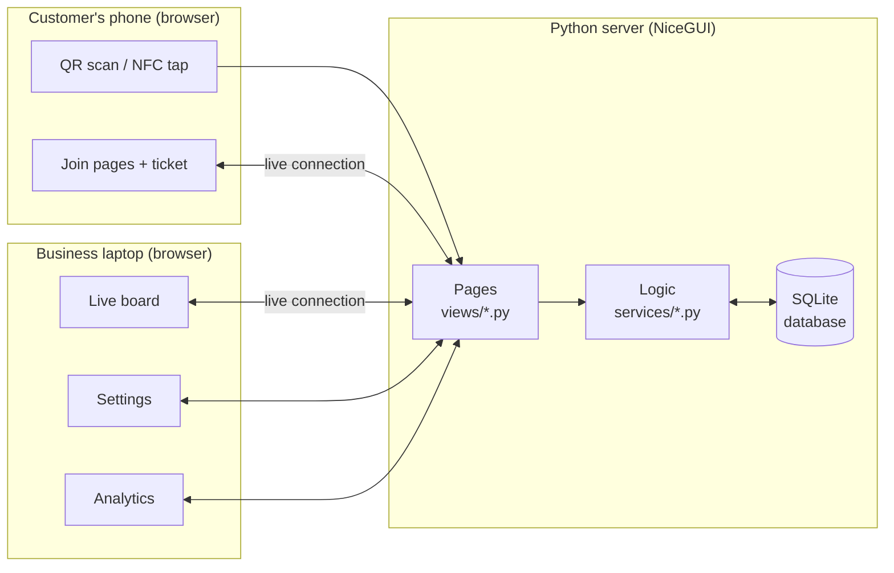

**How to explain it:** the code is split into two layers.
1. **`views/`**: the pages. Each one is a Python function that builds the screen out of `ui.*` elements.
2. **`services/`**: the real logic (queue rules, join steps, analytics, charts). Plain Python with no web code, so it's easy to test.

---

## 6. Folder layout

```
dashq/
├── main.py             starts the app (python main.py), file addresses, security headers
├── config.py           settings from environment variables
├── db.py               the tables and the database connection
├── views/              PAGES (Python only)
│   ├── landing.py        home page
│   ├── auth_pages.py     sign up, log in, sample businesses
│   ├── customer.py       join pages, ticket, alert, stop alert
│   ├── board.py          live board, drag and drop, add in person, resend alert
│   ├── settings_page.py  the five settings tabs
│   ├── analytics_page.py the 8 charts
│   ├── dashboard_frame.py top bar with the big buttons
│   └── common.py         colours, logo, login helpers
├── services/           LOGIC (queue.py, join_flow.py, accounts.py, pages.py,
│                               analytics.py, charts.py, sample_data.py, sound.py, qr.py)
├── static/             the logo, favicon and chart font (pictures and fonts only)
└── tests/              pytest tests
```

---

## 7. How a NiceGUI page works

This is the core idea to explain. A page is just a Python function:

```python
@ui.page("/b/{slug}/t/{code}")
def ticket_page(slug, code):
    ui.label("YOUR TOKEN")
    ui.label(ticket["token"]).classes("text-7xl")
    ui.button("Leave the line", on_click=leave)
    ui.timer(3, refresh)        # check for changes every 3 seconds
```

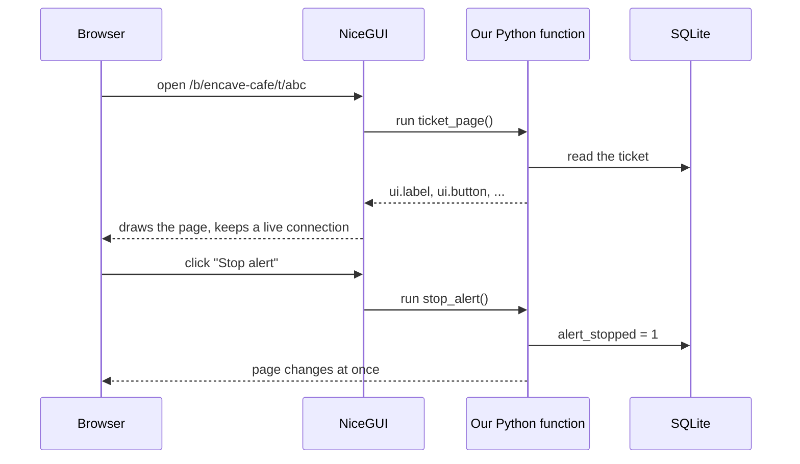

---

## 8. Database tables

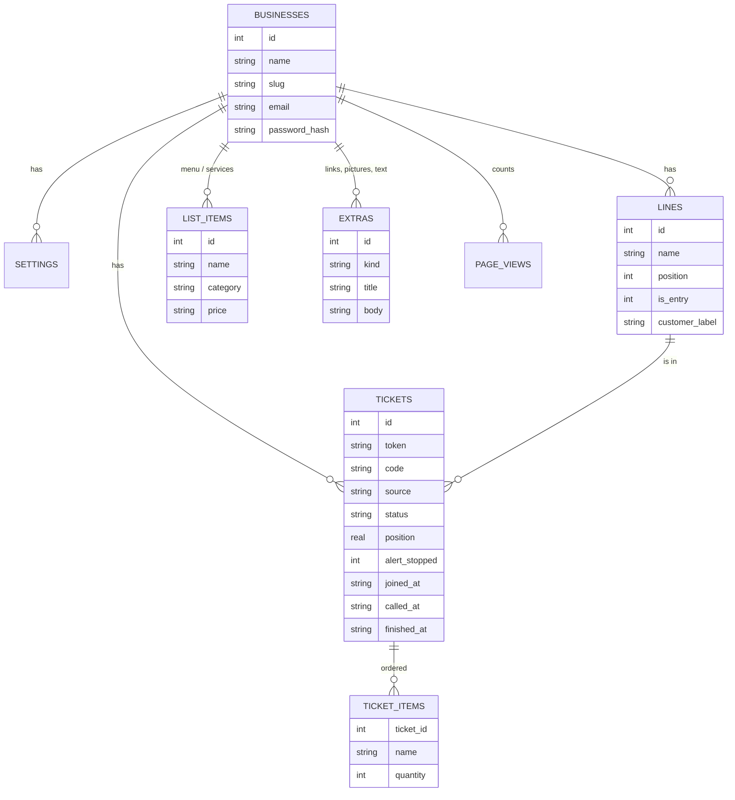

- The tables are written as one SQL string inside `db.py`.
- **Every table has `business_id`**, and every query filters by it, so one business can never see another's data. A test checks this.
- A **ticket** is one customer. `status` is `waiting → called → done` (or `left`). `source` is `qr`, `nfc` or `ip`.
- Deleting a business removes all its rows automatically (`ON DELETE CASCADE`).

---

## 9. Flowchart: a customer joins (QR / NFC)

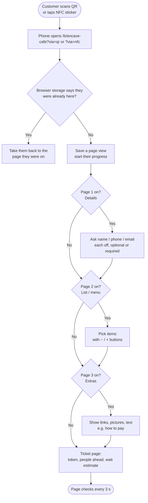

**Point to make:** the progress is saved in **NiceGUI's browser storage** (`app.storage.user`), which is tied to a signed cookie. If the customer closes the tab by mistake and scans again, they land back on the same step.

### When is the token handed out?

The business chooses: **right away**, **after page 1**, **after page 2**, or **at the end**.

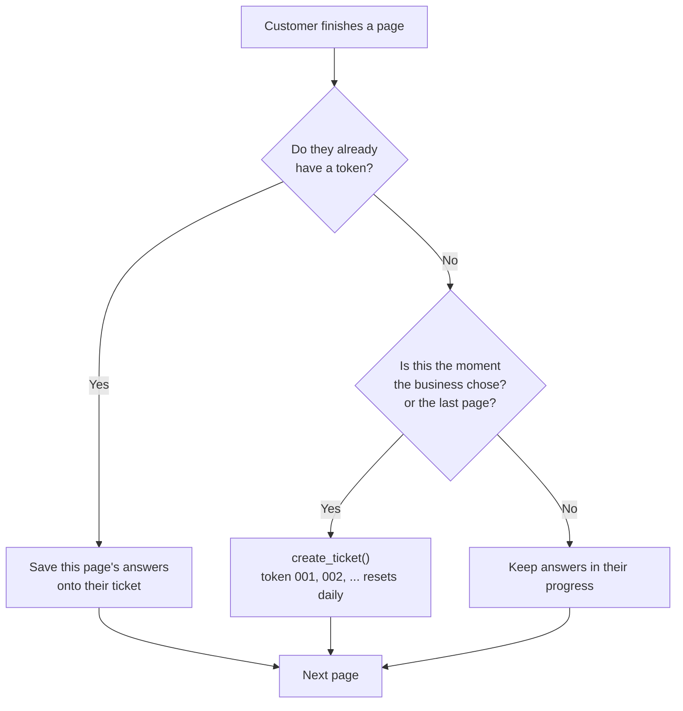

Code: `issue_ticket_if_due()` in `services/join_flow.py`, `create_ticket()` in `services/queue.py`.

---

## 10. Flowchart: how the live board updates

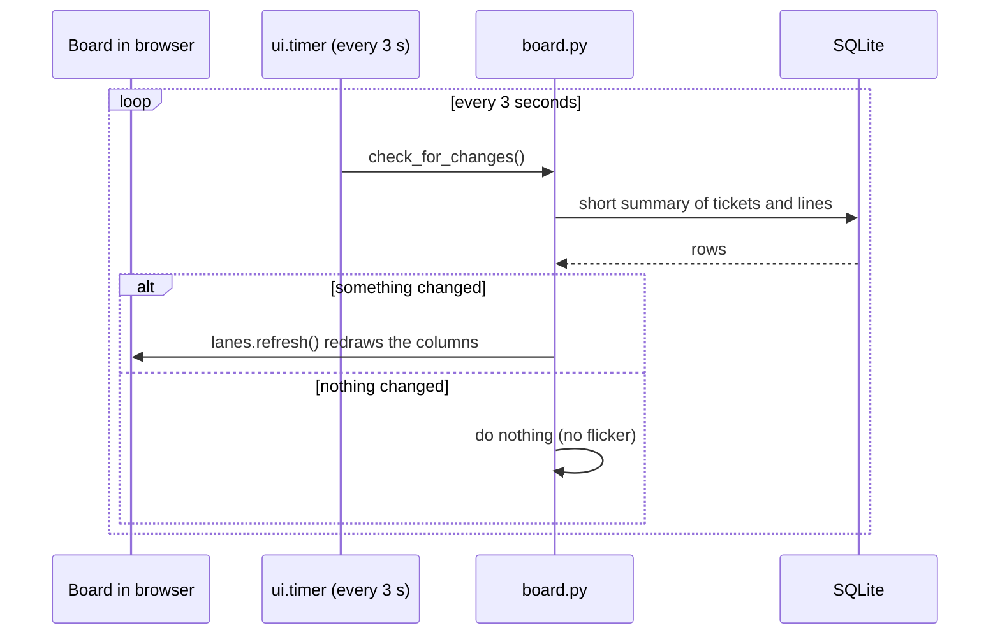

In the code it's two lines:

```python
@ui.refreshable          # a part of the page that can be redrawn
def lanes(): ...

ui.timer(3, check_for_changes)
```

**Why it matters:** if someone joins on their phone, their card appears on the board within 3 seconds (with a light-blue ring for "just joined"), and nobody presses refresh. Pressing a button redraws the board straight away.

---

## 11. Flowchart: staff call someone → the customer's phone flashes red

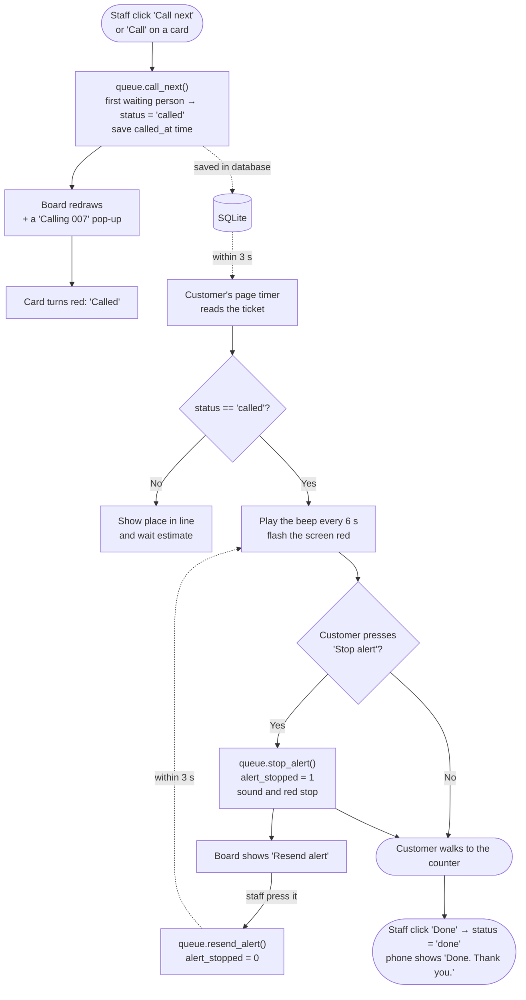

**How the red flash works, in Python:** a `ui.timer(0.6, flash_tick)` switches the page background between dark red and light red while it's their turn:

```python
ui.query("body").classes(add="bg-red-600", remove="bg-red-100")
```

**Fun detail for the talk:** the beep isn't a downloaded sound file. Python **makes** it in `services/sound.py` with the `wave` module: three 880 Hz sine-wave beeps written as a WAV file. The page plays it with `ui.audio(...).play()`.

> Phones only allow sound after the user taps something, so the ticket page has a "Tap to turn on sound alerts" button.

---

## 12. Flowchart: drag and drop to reorder / move lines

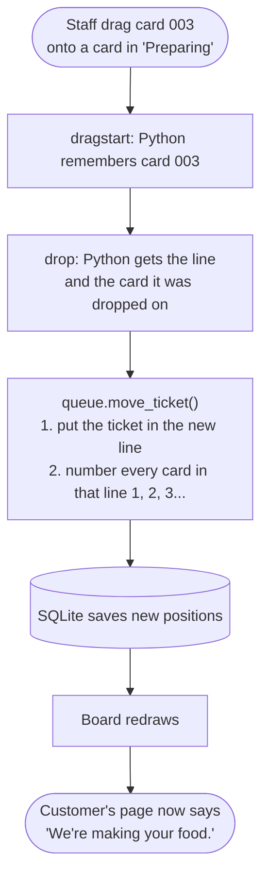

```python
ui.card().props("draggable") \
    .on("dragstart", lambda: state.update(dragging=ticket_id)) \
    .on("drop", lambda: drop(line_id, before_id))
```

- Each **line** has a **customer message** ("Your food is ready. Collect it at the counter."), so moving a card changes what the customer sees.
- The board **doesn't redraw while you're dragging**, so nothing jumps under your mouse. "Add in person" opens in a pop-up, so typing is never interrupted either.

---

## 13. Flowchart: analytics (pandas → matplotlib/seaborn → SVG)

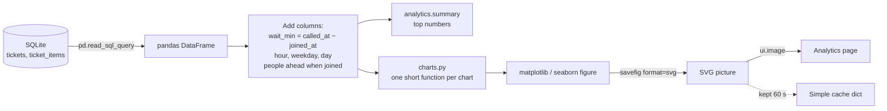

### The 8 charts

| Chart | Type | Library call | Answers |
|---|---|---|---|
| People joining per day | Line + fill | `sns.lineplot` | Is business growing? |
| How people join | Donut / pie | `ax.pie` | QR vs NFC vs in person |
| Busiest times | Heatmap | `sns.heatmap` | Which day + hour is busiest |
| Wait time by hour | Bar | `sns.barplot` | Slowest hour (darkest bar) |
| Most selected from list | Horizontal bar | `sns.barplot` | Top-selling items |
| Longer line, longer wait? | Scatter + trend line | `sns.scatterplot` + `sns.regplot` | Does wait grow with line length? |
| How long people wait | Histogram + curve | `sns.histplot(kde=True)` | Typical wait, with the median marked |
| Completed vs left | Stacked bar | `sns.histplot(multiple="stack")` | Which days people give up |

**Why SVG?** It stays sharp at any size. The charts are drawn in a background thread (`run.io_bound`), so other users aren't held up while they're made.

---

## 14. Flowchart: sign up and log in

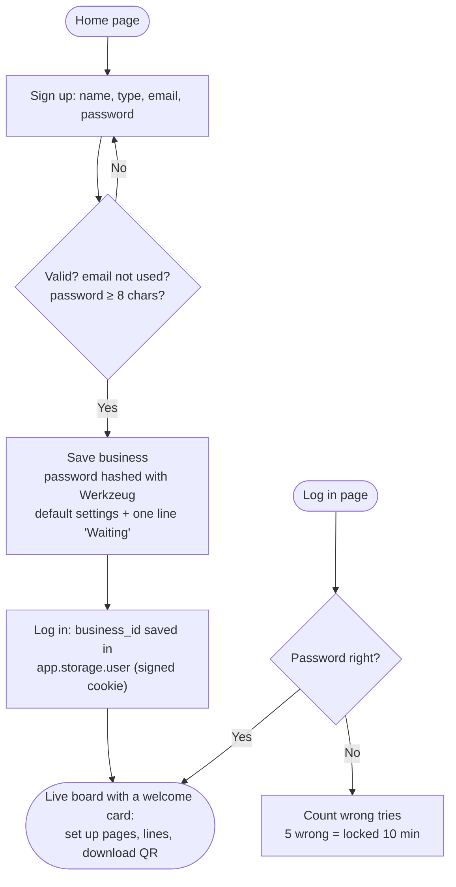

Every dashboard page starts with `require_login()`. It loads the logged-in business, or sends you to the login page.

---

## 15. Security (short list for questions)

- **Passwords are hashed**, never stored as plain text.
- **5 wrong passwords** lock the account for 10 minutes.
- **`business_id` on every query**, with a test proving business A can't see or change business B's data.
- **Clicks go over NiceGUI's live connection**, tied to that browser's page. There are no forms another website could submit.
- **Uploads** must be JPEG/PNG/WebP under 4 MB. Pillow re-saves each one, which removes hidden data like GPS, and gives it a random name.
- **Links** must start with `https://`, `http://` or `upi://`, which blocks `javascript:` tricks.
- **Security headers** on every response (no framing, no content sniffing, HTTPS only on the server).

---

## 16. How we tested it

- **20 pytest tests**, each with a fresh temporary database.
- **16 tests call the Python logic directly**: sign up, lockout, page/token combinations, call/done/move/reorder, deleting lines, isolation between businesses, stop/resend alert, analytics with sample data.
- **4 tests click through the real pages** with NiceGUI's `User` test helper (no browser needed): sign up → board, login required, customer joins → turn → Stop alert, home page.
- Run them with `.venv/bin/python -m pytest -q`.
- **Sample data:** when the app starts, it creates **Encave** (a cafe at MIT-WPU with a menu, Ordered → Preparing → Ready) and **Sociovate** (a dental clinic, Waiting room → With the doctor), each with 30 days of realistic fake history, so every chart has data.

---

## 17. Likely questions and short answers

| Question | Answer |
|---|---|
| Why NiceGUI? | It lets us build the whole web app in Python. No separate HTML, CSS or JavaScript to write or explain. |
| Is there really no JavaScript? | Not in our code. NiceGUI brings its own browser code inside the library, like pandas brings its own C code. |
| How is it live? | NiceGUI keeps a live connection (WebSocket) to each browser. A 3-second `ui.timer` checks the database and redraws only when something changed. |
| How does NFC work? | The sticker only stores a URL. The phone opens it like a link, and `?via=nfc` tells us how they joined. |
| What if the customer closes the page? | Their progress and ticket code are in NiceGUI's browser storage. Scanning again brings them back. |
| How is the wait time estimated? | People ahead × the business's average minutes per customer (set in settings). |
| Where's the data stored? | One SQLite file. Fine for one server. Postgres would be the next step for bigger scale. |
| Is there an app to install? | No. Everything runs in the phone's browser. |
| Any paid APIs? | None yet. SMS alerts and calling are listed as coming features. |
| What's next? | SMS alerts, calling, more customisation, features for each type of business. |

---

## 18. One-slide summary

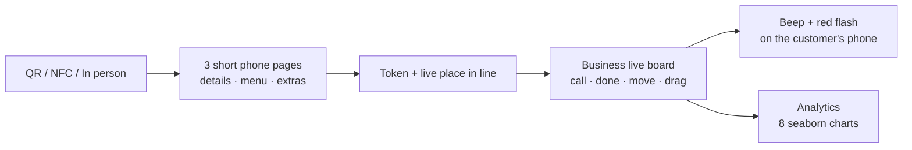

**Stack in one line:** 100% Python: NiceGUI for the pages, SQLite for data, pandas + matplotlib/seaborn for analytics. No HTML, CSS or JavaScript files. No paid APIs.
