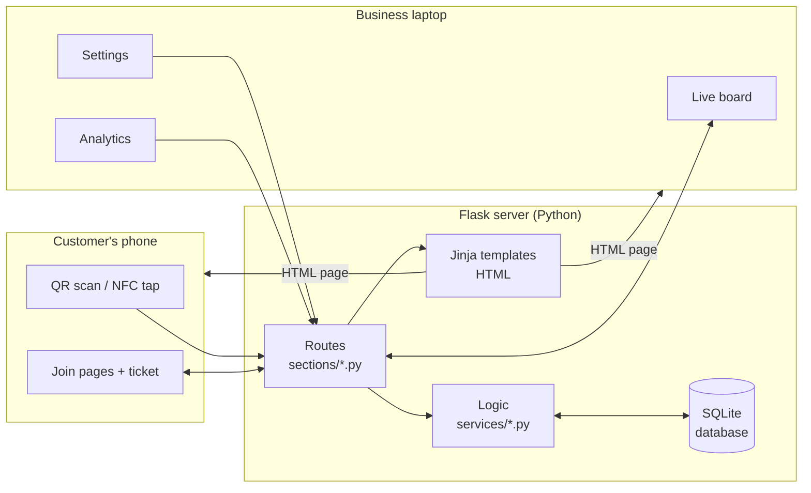
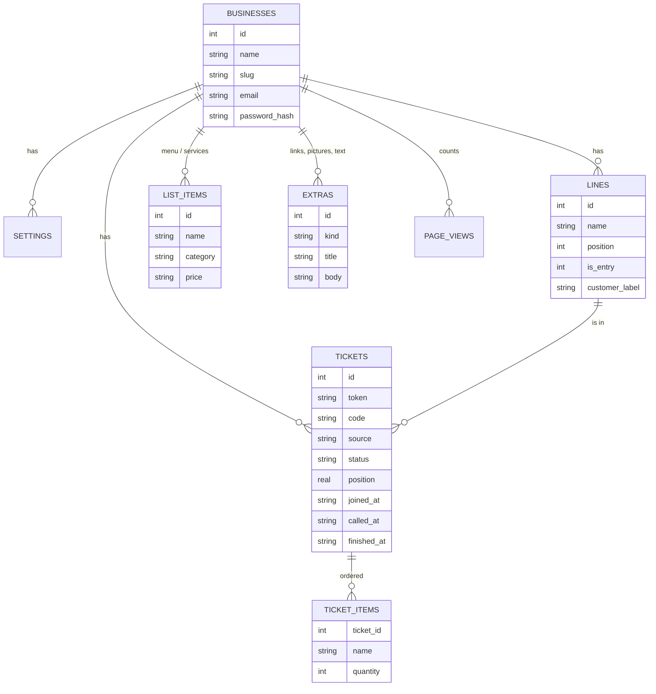
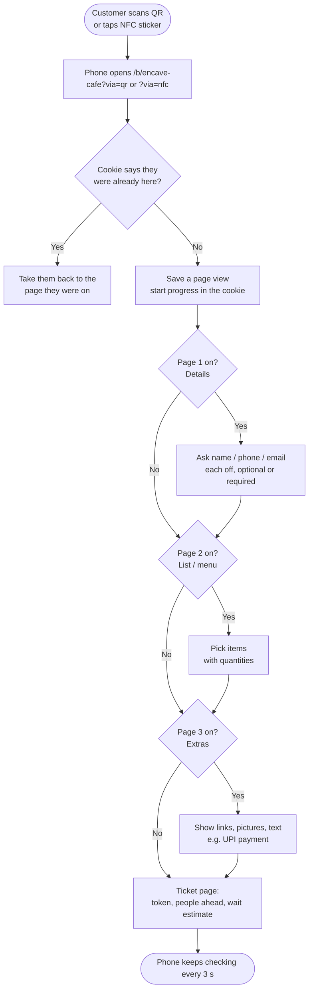
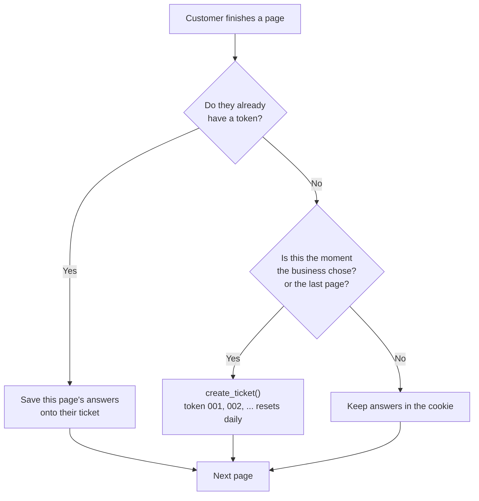
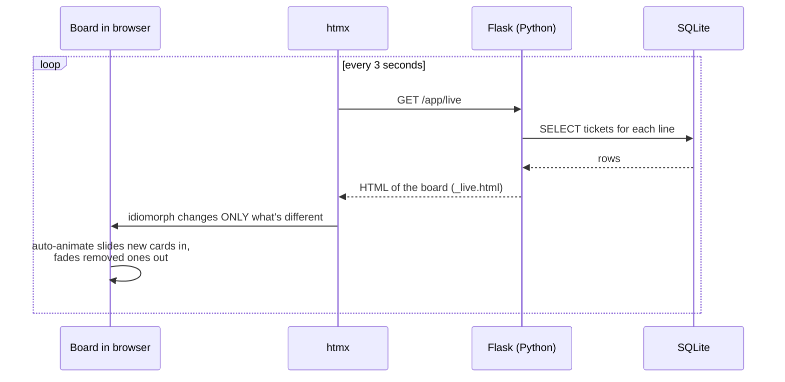
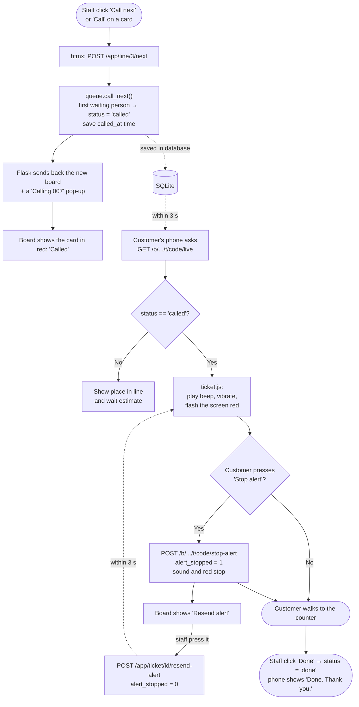
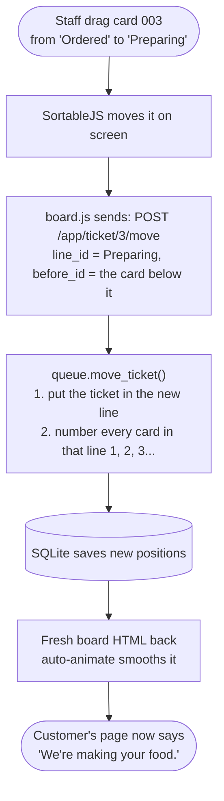
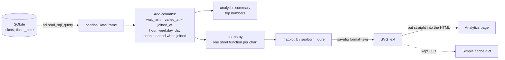
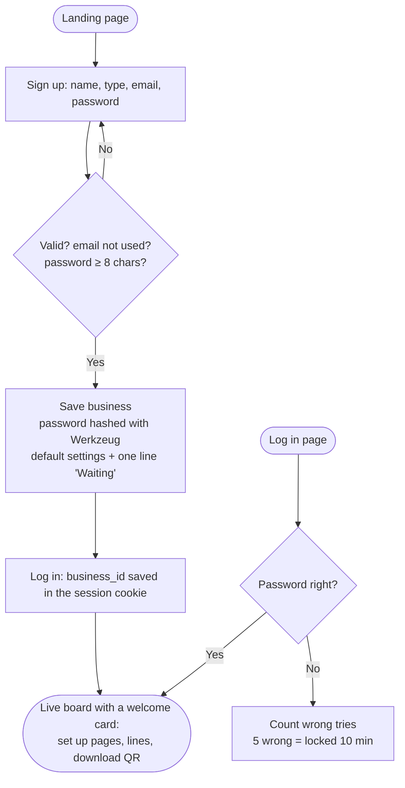
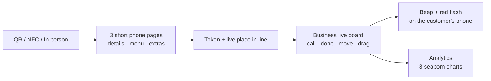

# dashQ: how it's built

*Notes for the presentation. The flowcharts use Mermaid. They render on GitHub, in VS Code (with a Mermaid preview extension), in Obsidian, and at [mermaid.live](https://mermaid.live), where you can paste one and export it as PNG/SVG for slides.*

---

## 1. What dashQ is (30-second version)

dashQ helps a business run its counter: queues, orders from a menu, and "your turn" alerts.

- A customer joins the line in one of **three ways** (*triple servicing*): **scan a QR code**, **tap an NFC sticker**, or **in person** (staff add them).
- The customer fills **up to 3 short pages** on their phone: details → pick from a list/menu → links/pictures/text. Then they get a **token**.
- The business sees everyone on a **live board** on the laptop and can call, complete, move and reorder people.
- When it's the customer's turn, their phone **beeps, vibrates and flashes red**. They can stop the alert, and staff can resend it.
- An **analytics** page draws charts about wait times, busy hours and popular items.

**One-line pitch:** *"Python does all the logic. Ready-made libraries handle the hard browser parts, so we didn't hand-write complex JavaScript."*

---

## 2. Languages used

| Language | Where | How much |
|---|---|---|
| **Python 3.12** | All the logic: routes, queue rules, database, analytics, charts, the alarm sound | Most of the project |
| **SQL** (SQLite) | Plain SQL strings called from Python (`sqlite3`), tables in `schema.sql` | Inside the Python files |
| **HTML + Jinja** | Page templates. Jinja is Python's template language (`{{ }}`, ``) | `templates/` |
| **CSS** | All the styling and animations (fade, slide, red flash, pulse) | One file: `static/css/dashq.css` |
| **JavaScript** | Only small glue code (4 files, each about 10–40 lines) | `static/js/` |

---

## 3. Libraries used

### Python libraries (`requirements.txt`)

| Library | What we use it for |
|---|---|
| **Flask** | The web framework: URLs → Python functions → HTML pages |
| **Jinja2** (comes with Flask) | Fills the HTML templates with data |
| **Flask-WTF** | CSRF protection, so other websites can't submit our forms |
| **Werkzeug** (comes with Flask) | Password hashing (`generate_password_hash`, `check_password_hash`) |
| **pandas** | Turns the tickets table into DataFrames for analytics (grouping, averages, pivot tables) |
| **NumPy** | Random numbers for the 30 days of sample data |
| **matplotlib** | Draws the charts and saves them as SVG |
| **seaborn** | Ready-made chart types on top of matplotlib (heatmap, histogram + curve, scatter + trend line) |
| **qrcode** | Makes each business's QR code image |
| **Pillow** | Checks uploaded pictures are real images, shrinks them and saves them again safely |
| **tzdata / zoneinfo** | Times shown in Indian time (`Asia/Kolkata`) |
| **gunicorn** | Runs the app on the server (Azure) |
| **pytest** | Automatic tests (17 tests) |

### Python standard library (built in, nothing to install)

| Module | Used for |
|---|---|
| `sqlite3` | The database |
| `secrets` | Random ticket codes for the customer's link |
| `wave`, `math`, `struct` | **Making the alarm beep sound in Python**: a sine wave written as a WAV file |
| `datetime`, `io`, `re`, `os` | Times, in-memory files, slugs ("Encave Cafe" → `encave-cafe`), file paths |

### Browser libraries (loaded from the jsDelivr CDN, fixed versions)

| Library | What it does for us | Why we didn't write it ourselves |
|---|---|---|
| **htmx** 2.0.4 | HTML attributes like `hx-get="/app/live" hx-trigger="every 3s"` make part of a page reload itself from Flask. Buttons use `hx-post` | Live updates without writing JavaScript |
| **idiomorph** 0.7.3 | When htmx swaps in new HTML, it changes **only what's different** | No flicker, and cards keep their place |
| **auto-animate** 0.8.2 | Any list that changes animates by itself: join = slide in, leave = fade out, move = glide | One line of code: `autoAnimate(list)` |
| **SortableJS** 1.15.6 | Drag and drop cards to reorder or move them to another line | Drag and drop is hard to get right by hand |

---

## 4. APIs used

**We use no paid or third-party APIs.** No SMS service, no payment gateway, no AI API. Everything runs on our own server.

| Kind | What | Notes |
|---|---|---|
| **Our own web routes** | Flask URLs (table below) | The browser talks only to our server |
| **Browser APIs** | `Audio` (plays the beep), `navigator.vibrate` (vibrates the phone), `IntersectionObserver` (landing page fade-ins), cookies | Built into every modern browser |
| **CDN** | jsDelivr serves the 4 JS libraries | Only downloads files. It isn't an API we call |
| **NFC** | **No NFC API needed.** The sticker just stores our URL (`/b/<business>?via=nfc`), and the phone opens it like a link | Written to a cheap NTAG sticker with any free NFC app |

### Main routes (the "API" of our own app)

| URL | Who | What it does |
|---|---|---|
| `/` | public | Landing page |
| `/app/signup`, `/app/login` | business | Make an account, log in |
| `/app` | business | Live board |
| `/app/live` | htmx, every 3 s | Sends back the fresh board HTML |
| `/app/line/<id>/next` | business | Call the next person in a line |
| `/app/ticket/<id>/call` · `/done` · `/move` · `/remove` | business | Actions on one person |
| `/app/line/<id>/add` | business | Add someone in person (IP) |
| `/app/settings/...` | business | Pages, list, extras, lines, business |
| `/app/analytics` | business | Charts |
| `/app/qr.png` | business | QR code image |
| `/b/<slug>` | customer | Start point for QR and NFC |
| `/b/<slug>/join/<page>` | customer | Page 1, 2 or 3 |
| `/b/<slug>/t/<code>` | customer | The ticket |
| `/b/<slug>/t/<code>/live` | htmx, every 3 s | Fresh ticket status |
| `/alert.wav` | customer | The beep sound, made by Python |

---

## 5. Big picture: how the parts connect



**How to explain it:** the code is split into three layers.
1. **`sections/`**: routes. These are short and only receive the request and send back a page.
2. **`services/`**: the real logic (queue rules, analytics, charts). No Flask code here, so it's easy to test.
3. **`templates/`**: the HTML the user sees.

---

## 6. Folder layout

```
dashq/
├── app.py              starts the app, security settings, error pages
├── auth.py             sign up, log in, "must be logged in" check
├── db.py, schema.sql   database connection and tables
├── sections/           ROUTES   (landing.py, customer.py, dashboard.py)
├── services/           LOGIC    (queue.py, accounts.py, pages.py,
│                                 analytics.py, charts.py, sample_data.py, sound.py, qr.py)
├── templates/          HTML pages (Jinja)
├── static/             css/dashq.css, js/ (4 small files), fonts/
└── tests/              pytest tests
```

---

## 7. Database tables



- **Every table has `business_id`**, and every query filters by it, so one business can never see another's data. A test checks this.
- A **ticket** is one customer. `status` is `waiting → called → done` (or `left`).
- `source` is `qr`, `nfc` or `ip`.
- Deleting a business removes all its rows automatically (`ON DELETE CASCADE`).

---

## 8. Flowchart: a customer joins (QR / NFC)



**Point to make:** the progress is saved in a **cookie** (Flask's signed session). If the customer closes the tab by mistake and scans again, they land back on the same step.

### When is the token handed out?

The business chooses: **right away**, **after page 1**, **after page 2**, or **at the end**.



Code: `issue_ticket_if_due()` in `sections/customer.py`, `create_ticket()` in `services/queue.py`.

---

## 9. Flowchart: how the live board updates (htmx + morph + auto-animate)

This is the core trick. **There's no complicated JavaScript.** Python renders HTML, and the libraries do the rest.



In the HTML it's just attributes:

```html
<div id="live" hx-get="/app/live" hx-trigger="every 3s" hx-swap="morph:innerHTML">
```

**Why it matters:** if someone joins on their phone, their card appears on the board within 3 seconds with a smooth animation, and nobody presses refresh.

---

## 10. Flowchart: staff call someone → the customer's phone flashes red



**Stop and resend:** the customer can press **Stop alert** to silence it. This saves `alert_stopped = 1` on the ticket. The staff card then shows **Resend alert**, which sets it back to 0, so the phone alerts again on its next 3-second check.

**Fun detail for the talk:** the beep isn't a downloaded sound file. Python **makes** it in `services/sound.py` with the `wave` module: three 880 Hz sine-wave beeps written as a WAV file.

> Phones only allow sound after the user taps something, so the ticket page has a "Tap to turn on sound alerts" button.

---

## 11. Flowchart: drag and drop to reorder / move lines



- Each **line** has a **customer message** ("Your food is ready! Collect it at the counter."), so moving a card changes what the customer sees.
- The board **pauses its 3-second refresh while you're dragging or typing**, so nothing jumps under your mouse.

---

## 12. Flowchart: analytics (pandas → matplotlib/seaborn → SVG)



### The 8 charts

| Chart | Type | Library call | Answers |
|---|---|---|---|
| People joining per day | Line + fill | `sns.lineplot` | Is business growing? |
| How people join | Donut / pie | `ax.pie` | QR vs NFC vs in person |
| Busiest times | Heatmap | `sns.heatmap` | Which day + hour is busiest |
| Wait time by hour | Bar | `sns.barplot` | Slowest hour (darkest bar) |
| Most selected from list | Horizontal bar | `sns.barplot` | Top-selling items |
| Longer line, longer wait? | Scatter + trend line | `sns.scatterplot` + `sns.regplot` | Does wait grow with line length? |
| How long people wait | Histogram + curve | `sns.histplot(kde=True)` | Typical wait, with the median marked |
| Completed vs left | Stacked bar | `sns.histplot(multiple="stack")` | Which days people give up |

**Why SVG?** It stays sharp at any size, the text uses our Inter font, and it needs no chart JavaScript.

---

## 13. Flowchart: sign up and log in



Every dashboard page goes through `login_required`. It loads the logged-in business, or sends you to the login page.

---

## 14. Security (short list for questions)

- **Passwords are hashed**, never stored as plain text.
- **CSRF tokens** on every form and every htmx request.
- **5 wrong passwords** lock the account for 10 minutes.
- **`business_id` on every query**, with a test proving business A can't see or change business B's data.
- **Uploads** must be JPEG/PNG/WebP under 4 MB. Pillow re-saves each one, which removes hidden data like GPS, and gives it a random name.
- **Links** must start with `https://`, `http://` or `upi://`, which blocks `javascript:` tricks.
- **Security headers** (Content-Security-Policy) let only our own scripts and jsDelivr run.

---

## 15. How we tested it

- **17 pytest tests**, each with a fresh temporary database.
- Covered: sign up, lockout, all page/token combinations, cookie resume, call/done/move/reorder, deleting lines, isolation between businesses, analytics with sample data, demo accounts.
- Run them with `.venv/bin/python -m pytest -q`.
- **Sample data:** `flask seed-demo` creates **Encave** (a cafe at MIT-WPU with a menu, Ordered → Preparing → Ready) and **Sociovate** (a dental clinic, Waiting room → With the doctor), each with 30 days of realistic fake history, so every chart has data.

---

## 16. Likely questions and short answers

| Question | Answer |
|---|---|
| Why Flask and not Django or React? | Flask is small and easy to explain. All our logic stays in Python, and there's no separate frontend app to build. |
| How is it "live" without WebSockets? | htmx asks the server every 3 seconds. For a cafe or clinic queue, 3 seconds is fast enough and much simpler. |
| How does NFC work? | The sticker only stores a URL. The phone opens it like a link, and `?via=nfc` tells us how they joined. |
| What if the customer closes the page? | Their progress and ticket code are in a cookie. Scanning again brings them back. |
| How is the wait time estimated? | People ahead × the business's average minutes per customer (set in settings). |
| Where's the data stored? | One SQLite file. Fine for one server. Postgres would be the next step for bigger scale. |
| Is there an app to install? | No. Everything runs in the phone's browser. |
| Any paid APIs? | None yet. SMS alerts and calling are listed as coming features. |
| What's next? | A TV display for the counter, real SMS alerts, several branches per business. |

---

## 17. One-slide summary



**Stack in one line:** Python (Flask, pandas, matplotlib/seaborn, SQLite) + HTML/CSS + 4 small JS libraries (htmx, idiomorph, auto-animate, SortableJS). No paid APIs.
